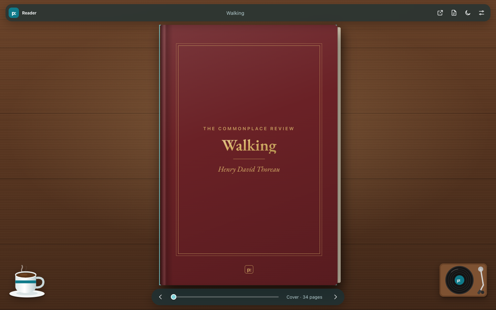
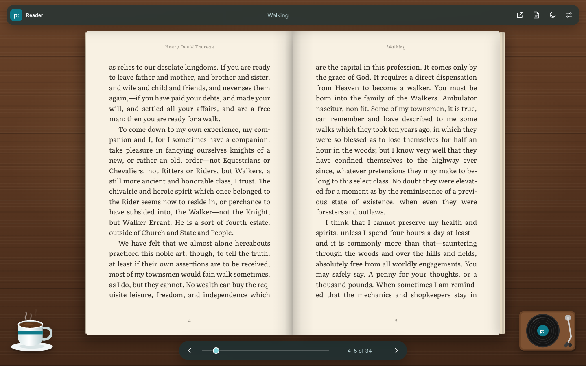
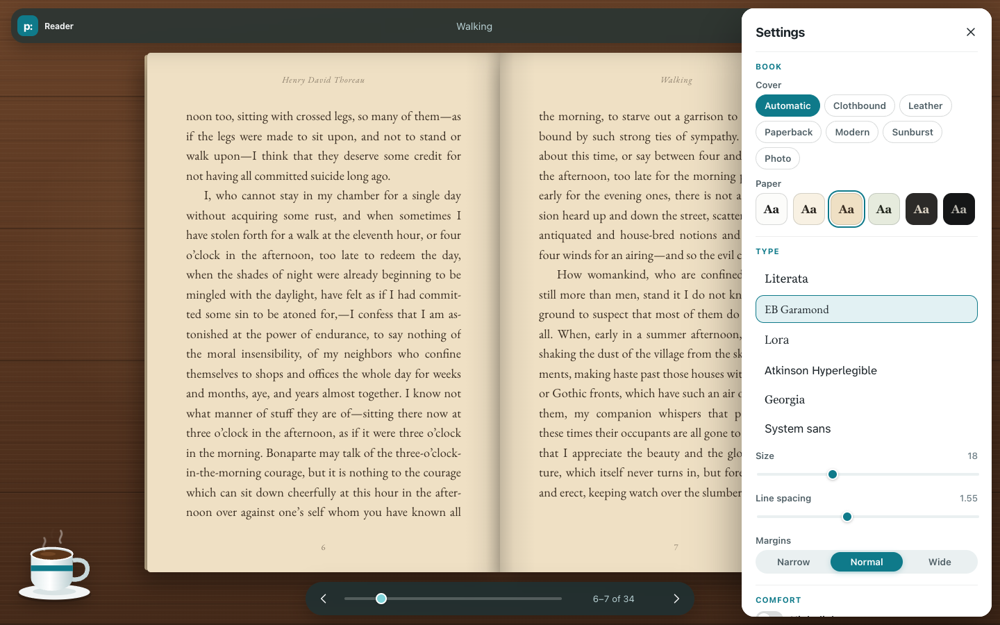
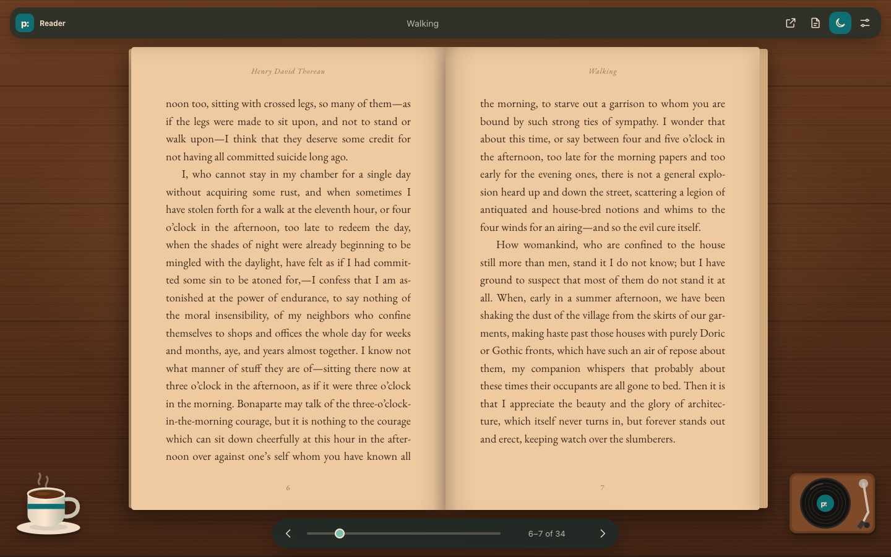
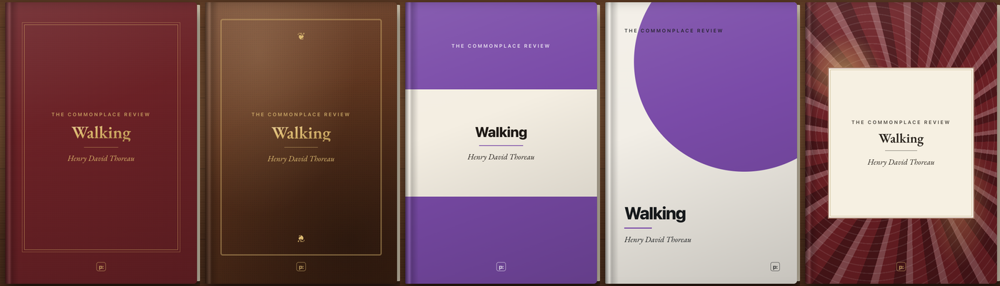

<p align="center">
  
</p>

<h1 align="center">petty: Reader</h1>

<p align="center"><strong>Read articles and PDFs like a book. Every feature free.</strong></p>

<p align="center">
  <a href="LICENSE"></a>
  
  
</p>

petty: Reader is a free, open source Chrome extension. Click it on an article and the page becomes a closed book on a desk. Open the cover, turn the pages, and read without the ads, sidebars, and pop-ups.

There's no premium tier. Covers, fonts, paper colors, the night light, your saved place, the coffee cup, ambience, page-turn sounds, and the record player are all included. No license key, account, analytics, or tracking. The article never leaves your browser.

This is part of the [Petty FOSS](https://envemedia.com/petty/) family. It's an independent take on the idea behind Bookify Web and doesn't use its code, branding, or assets.

## A look inside

<table>
  <tr>
    <th>Start with a closed book</th>
    <th>Read in spreads</th>
  </tr>
  <tr>
    <td></td>
    <td></td>
  </tr>
  <tr>
    <th>Pick your fonts and paper</th>
    <th>Warm it up at night</th>
  </tr>
  <tr>
    <td></td>
    <td></td>
  </tr>
</table>

<p align="center"></p>

## What you get

- **A real book.** The article opens as a closed, standard-size book. Click the cover to open it, then turn pages with the page edges, the arrow keys, or a swipe. The slider jumps straight to any page.
- **Links still work.** Article links open in a new tab. Footnote links jump to the right page.
- **Text PDFs.** Open a PDF in Chrome and click the button, or right-click the button and choose **Open a PDF file…** for one on your computer. Headings, paragraphs, and link annotations come through. Running headers and page numbers are dropped.
- **Covers.** Clothbound, leather, paperback, modern, sunburst, or the article's own photo. The colors come from the title, so each book looks a little different.
- **Type and paper.** Literata, EB Garamond, Lora, Atkinson Hyperlegible, Georgia, or your system font. Six paper colors from white to night, plus size, line spacing, and margins.
- **Night light.** A warm filter with adjustable warmth. Press <kbd>N</kbd>.
- **Your place, saved.** Close the tab and come back later. The book opens where you left off, even if you've changed fonts since.
- **The desk.** A coffee cup you can sip from (it runs out, then refills). Four ambience tracks: lo-fi, rain, forest, and coffee shop. Two page-turn sounds: crisp paper and hardcover. A record player that plays a YouTube link you choose.

## Install

petty: Reader isn't in the Chrome Web Store yet, so you add it to Chrome yourself. It takes about two minutes, and you only do it once.

1. **Download it.** [Download the ZIP](https://github.com/petty-foss-dev/Petty-Reader/archive/refs/heads/main.zip). You'll get `Petty-Reader-main.zip`.
2. **Unzip it somewhere it can stay.** On a Mac, double-click the ZIP. On Windows, right-click it and choose **Extract All**. Move the `Petty-Reader-main` folder somewhere permanent, like Documents. Chrome runs the extension from this folder, so if you delete it, the extension stops working.
3. **Open Chrome's extensions page.** Type `chrome://extensions` in the address bar and press Enter, or open the **⋮** menu and choose **Extensions → Manage Extensions**.
4. **Turn on Developer mode** with the switch in the top-right corner.
5. **Load it.** Click **Load unpacked**, open the `Petty-Reader-main` folder, select the `extension` folder inside it, and click **Select**.
6. **Pin it.** Click the puzzle-piece icon next to the address bar, then the pin next to **petty: Reader**.

It works the same way in Edge (`edge://extensions`), Brave (`brave://extensions`), Arc, and other Chromium browsers.

**Updating:** download the ZIP again, replace your old `Petty-Reader-main` folder with the new one in the same place, then click the circular reload arrow on the petty: Reader card at `chrome://extensions`. Your settings and saved places stay put.

There's also a step-by-step page at [envemedia.com/petty/reader](https://envemedia.com/petty/reader/).

## Use it

Open an article and click the petty: Reader button, or press <kbd>Alt</kbd>+<kbd>Shift</kbd>+<kbd>B</kbd>.

| Key | Does |
|---|---|
| <kbd>→</kbd> <kbd>Space</kbd> <kbd>Page Down</kbd> | Next page |
| <kbd>←</kbd> <kbd>Shift</kbd>+<kbd>Space</kbd> <kbd>Page Up</kbd> | Previous page |
| <kbd>Home</kbd> / <kbd>End</kbd> | First / last page |
| <kbd>Enter</kbd> | Open the book |
| <kbd>N</kbd> | Night light |
| <kbd>S</kbd> | Settings |
| <kbd>Esc</kbd> | Close settings |

Going back past the first page closes the book.

## Privacy and permissions

Everything runs in your browser. Nothing is sent anywhere except the YouTube video you choose to play.

| Permission | Why |
|---|---|
| `activeTab`, `scripting` | Read the article on the tab you clicked the button on, and only that tab. |
| `storage` | Settings, your place in each book, and how much coffee is left. |
| `contextMenus` | The **Open a PDF file…** item on the toolbar button. |
| `declarativeNetRequestWithHostAccess` | YouTube rejects embeds without a web referrer, and extension pages don't send one. This adds one to the record player's own embed and nothing else. |
| Optional site access | Asked for only when you open a PDF from a website, or the first time you press play on the record player. |

## Limits

- Scanned PDFs with no selectable text need OCR, which isn't supported yet.
- PDFs with complicated multi-column layouts may come out in the wrong order.
- Chrome doesn't let extensions read some pages, like the Chrome Web Store and `chrome://` pages.

## Development

There's no build step. Edit the files in `extension/` and reload the extension at `chrome://extensions`.

To update the bundled libraries and fonts:

```sh
npm install
npm run vendor
```

| Path | What's there |
|---|---|
| `extension/background.js`, `extract.js` | Toolbar button and article extraction |
| `extension/reader/book.js` | Pagination, spreads, page turns, and the cover |
| `extension/reader/pdf-text.js` | Turns PDF text into paragraphs and headings |
| `extension/reader/audio.js` | Synthesized ambience and sound effects |
| `extension/reader/covers.js` | Cover designs |
| `extension/reader/desk.js` | Coffee cup and record player |

## License

[AGPL-3.0-only](LICENSE). Bundled libraries and fonts keep their own licenses. See [THIRD_PARTY_NOTICES.md](THIRD_PARTY_NOTICES.md).
